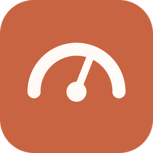

<p align="center"></p>

# Claude Limits

Claude kullanım limitlerinizi çalıştığınız yerde gösterir:

| İstemci | Nerede görünür | Platform |
|---|---|---|
| **VS Code eklentisi** | Durum çubuğu (`5s 42% · 7g 18%`), üzerine gelince tablo, tıklayınca panel | Windows, macOS, Linux |
| **Visual Studio eklentisi** | Durum çubuğu göstergesi + *Claude Limits* araç penceresi | Windows — VS 2022 (17.x) ve VS 2026 (18.x) |
| **Tray uygulaması** | Windows görev çubuğu (renkli yüzde ikonu) / macOS menü çubuğu (yazı) + popup | Windows, macOS |
| **Tarayıcı eklentisi** | Araç çubuğu rozeti + popup (claude.ai oturumunuzdan) | Chrome, Edge (MV3) |

> Claude masaüstü uygulaması eklenti desteklemediği için onun yerine **tray uygulaması** ve **tarayıcı eklentisi** var.
> Abonelik limitleri hesap bazındadır; Claude uygulaması, claude.ai ve Claude Code aynı limitleri paylaşır.
> Visual Studio for Mac 2024’te emekliye ayrıldığı için Visual Studio eklentisi yalnızca Windows içindir; macOS’ta VS Code eklentisi ve tray uygulaması aynı bilgiyi verir.

## Neyi gösterir?

**Abonelik limitleri (Pro / Max / Team)** — Claude Code’daki `/usage` ile aynı veri:
5 saatlik oturum, haftalık (tüm modeller), model bazlı haftalık limitler (ör. *Haftalık · Opus*), ek kullanım;
her biri için yüzde ve sıfırlanmaya kalan süre. O an hesabı sınırlayan limit **bağlayıcı** olarak işaretlenir.

**API limitleri (isteğe bağlı)**
- *API anahtarı* (`sk-ant-api…`) girerseniz: dakikalık istek / girdi token / çıktı token limitleri ve kalanlar.
  Ölçüm, 1 token’lık küçük bir istekle yapılır (varsayılan 15 dakikada bir; maliyeti ihmal edilebilir). Limitler model sınıfı başınadır — ayarlardan en çok kullandığınız modeli seçin.
- *Admin API anahtarı* (`sk-ant-admin…`, yalnızca kuruluş hesapları) girerseniz: bu ayki ve bugünkü harcama, bugünkü tokenlar, isteğe bağlı aylık bütçe yüzdesi.

Varsayılan eşikler: **%75** turuncu, **%90** kırmızı; eşik aşılınca bildirim.

## Veri nereden geliyor?

| Veri | Kaynak | Kimlik |
|---|---|---|
| Abonelik (VS Code, VS, tray) | `GET api.anthropic.com/api/oauth/usage` | Bu bilgisayardaki Claude Code girişi: Windows/Linux `~/.claude/.credentials.json`, macOS Anahtar Zinciri (*Claude Code-credentials*) |
| Abonelik (tarayıcı) | `GET claude.ai/api/organizations/{org}/usage` | Tarayıcıdaki claude.ai oturumu |
| Rate limit | `POST api.anthropic.com/v1/messages` yanıt başlıkları (`anthropic-ratelimit-*`) | API anahtarı |
| Harcama | `GET /v1/organizations/cost_report` ve `/usage_report/messages` | Admin API anahtarı |

- Claude Code token’ı **yalnızca okunur**; asla yenilenmez veya değiştirilmez (yenilemek Claude Code oturumunuzu kapatabilirdi). Süresi dolmuşsa Claude Code’u bir kez kullanmanız yeterli.
- Abonelik uç noktası resmi olarak belgelenmiş bir API değildir (Claude Code’un `/usage` komutunun kullandığı uç noktadır); Anthropic değiştirirse ayrıştırıcı güncellenmelidir. Ayrıştırıcı hem yeni `limits[]` dizisini hem de eski düz alanları (`five_hour`, `seven_day`, …) okur.
- Tüm istemciler sonuçları `~/.claude-limits/cache.json` dosyasında paylaşır; birden fazla VS Code penceresi, tray ve Visual Studio açıkken uç nokta tek bir yerden çağrılmış gibi davranır. Bu dosyada gizli anahtar bulunmaz ([biçim](docs/cache-format.md)).
- Anahtarlar: VS Code → SecretStorage, Visual Studio → Windows DPAPI, tray → Windows DPAPI / macOS Anahtar Zinciri (Electron safeStorage), tarayıcı → eklentinin yerel deposu.

## Şirket ağı / proxy

Araçlar `claude` gibi davranır: `HTTPS_PROXY` / `HTTP_PROXY` / `NO_PROXY` ortam değişkenlerini okur, şirket sertifikalarını
`NODE_EXTRA_CA_CERTS` dosyasından ve Windows/macOS sertifika deposundan alır. Varsayılan **`auto`** modunda önce proxy denenir;
proxy’ye ulaşılamazsa (ör. ofis dışında) **otomatik olarak doğrudan bağlanılır** ve çalışan yol 10 dakika hatırlanır — yani
`claude` / `claude-direct` ayrımına gerek kalmaz. İsterseniz ayarlardan `direct` veya sabit bir `http://sunucu:port` seçebilirsiniz
(VS Code: `claudeLimits.network.proxy`, Visual Studio: *Bağlantı (proxy)*, tray: Ayarlar → *Bağlantı*). Ortam değişkeni yoksa
Visual Studio eklentisi Windows proxy ayarını, VS Code eklentisi `http.proxy` ayarını kullanır. Tarayıcı eklentisi tarayıcının
kendi proxy ayarını kullanır.

## Kurulum

Hazır paketleri **GitHub Actions** üretir (aşağıya bakın). Kurulum adımları:

### VS Code
`claude-limits.vsix` → VS Code’da *Extensions* görünümü → `…` → **Install from VSIX…** (veya `code --install-extension claude-limits.vsix`).
Komut paleti: **Claude Limits: API anahtarı gir**, **…Admin API anahtarı gir**, **…Şimdi yenile**, **…Ayrıntıları göster**.
Cursor / Windsurf gibi VS Code tabanlı editörlerde de çalışır.

### Visual Studio 2022 / 2026
`ClaudeLimits.vsix` dosyasına çift tıklayın → VS 2022 ve/veya 2026 seçin → Visual Studio’yu yeniden başlatın.
*Görünüm → Diğer Pencereler → Claude Limits*; ayarlar: *Araçlar → Seçenekler → Claude Limits*. Ayrıntılar: [visual-studio-extension/README.md](visual-studio-extension/README.md).

### Tray uygulaması
- **Windows:** `Claude-Limits-Setup-1.0.0-x64.exe` (ARM için `-arm64`) veya kurulumsuz `…-portable.exe`. İmzasız olduğu için SmartScreen “Yine de çalıştır” isteyebilir.
- **macOS:** `Claude-Limits-1.0.0-mac-arm64.dmg` (Intel: `x64`) → *Uygulamalar*’a sürükleyin. Ad-hoc imzalı olduğu için ilk açılışta *sağ tık → Aç* gerekir (gerekirse `xattr -dr com.apple.quarantine "/Applications/Claude Limits.app"`).
  İlk okumada macOS, Claude Code anahtarına erişim için izin sorar → **Her Zaman İzin Ver**.
- Sol tık: popup · sağ tık: menü (yenile, ayarlar, oturum açılışında başlat, çıkış). Ayarlar popup’taki ⚙ düğmesinde.

### Tarayıcı (Chrome / Edge)
`claude-limits-browser-1.0.0.zip` dosyasını bir klasöre açın → `chrome://extensions` (Edge: `edge://extensions`) → **Geliştirici modu** → **Paketlenmemiş öğe yükle** → klasörü seçin.
claude.ai’ye giriş yapmış olmanız yeterli; rozet 5 saatlik oturum yüzdesini gösterir.

## Kaynaktan derleme

Gereksinimler: Node.js 20+ (VS eklentisi için ayrıca Windows + Visual Studio 2022 *Visual Studio extension development* iş yükü veya .NET 8 SDK + MSBuild).

```bash
npm ci && npm test                       # ortak çekirdek (16 birim testi)
cd vscode-extension && npm ci && npm test && npm run package    # → claude-limits.vsix
cd browser-extension && npm ci && npm test                      # → build/ ve .zip
cd tray-app && npm ci && npm start                              # geliştirme modunda çalıştır
cd tray-app && npm run dist:win     # Windows’ta → release/*.exe
cd tray-app && npm run dist:mac     # macOS’ta  → release/*.dmg
cd visual-studio-extension && ./build.ps1                       # Windows’ta → artifacts/ClaudeLimits.vsix
```

**Tek seferde tüm paketler:** depoyu GitHub’a gönderin; `.github/workflows/build.yml` her push’ta Linux, Windows ve macOS üzerinde
testleri çalıştırıp tüm paketleri *Artifacts* olarak yükler. `v1.0.0` gibi bir etiket gönderirseniz paketler bir GitHub Release’e eklenir.

**Gerçek hesaba dokunmadan deneme:** `npm run mock` yerel bir sahte Anthropic sunucusu başlatır;
istemcileri `CLAUDE_LIMITS_API_BASE=http://127.0.0.1:8787` ortam değişkeniyle çalıştırın (bu değişken kurumsal proxy için de kullanılabilir).

## Proje yapısı

```
core/                     Ortak TypeScript çekirdek: ayrıştırıcılar, HTTP, kimlik okuma, paylaşılan önbellek, HTML çizici
vscode-extension/         VS Code eklentisi (esbuild ile tek dosyaya paketlenir)
visual-studio-extension/  VS 2022/2026 VSIX (C#, net472) + .NET çekirdek kütüphanesi ve xUnit testleri
tray-app/                 Electron tray/menü çubuğu uygulaması (Windows + macOS)
browser-extension/        Chrome/Edge MV3 eklentisi
scripts/                  İkon üretici, sahte Anthropic sunucusu
docs/                     Önbellek dosyası biçimi
```

Lisans: MIT
